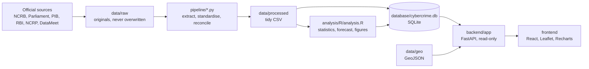

# Architecture

Data flows one way, from source files to the browser. The website has no write path.

## Folder structure

| Path | Purpose |
|---|---|
| `data/raw/` | Original downloads. Pipeline code only reads these |
| `data/curated/sources.csv` | The source register |
| `data/processed/` | Cleaned CSV files, also offered as downloads |
| `data/geo/` | Simplified GeoJSON and its licence |
| `pipeline/` | Extraction, cleaning and database build |
| `analysis/R/`, `analysis/outputs/` | R script, its results and figures |
| `database/` | `schema.sql` and the built SQLite database |
| `backend/app/` | `main.py` routes, `service.py` queries, `analytics.py` formulas, `repository.py` DB access |
| `frontend/src/` | `pages/`, `components/`, `content/`, `api.ts`, `format.ts` |
| `tests/` | Automated tests |
| `scripts/` | One-off research helpers used while exploring sources |
| `docs/` | Documentation |

## Database design

Each reporting system has its own table, which makes accidental mixing impossible:
`cybercrime_statistics`, `crime_head_statistics` and `motive_statistics` (NCRB), `financial_statistics` (NCRP), `cert_in_incidents` (CERT-In) and `bank_fraud_statistics` (RBI). Estimates live separately in `forecasts`.

The suggested tables `states`, `cybercrime_statistics`, `financial_statistics`, `population_statistics` and `data_sources` all exist. Every statistic has a `source_id` foreign key. The national row uses `state_id = 0` ('IN'), which queries exclude when summing States. `reported_cases` is nullable, because NULL means unavailable and 0 means a reported zero.

`crime_heads.level` prevents double counting: level 1 heads are mutually exclusive and add up to the total, and level 2 and 3 are sub-heads that are never summed with their parents.

SQLite suits a read-only prototype. `schema.sql` is close to standard SQL, so moving to PostgreSQL mostly means changing the connection code in `repository.py`.

## API

Interactive documentation is at `/docs` when the server runs.

| Endpoint | Purpose |
|---|---|
| `GET /api/health` | Status |
| `GET /api/meta` | Years, States, categories, metrics, coverage matrix |
| `GET /api/national/overview?year=` | Dashboard cards |
| `GET /api/national/trend` | NCRB, NCRP and CERT-In series, kept separate |
| `GET /api/states`, `GET /api/states/{code}` | State list and full profile |
| `GET /api/comparison/map?year=&metric=&category=` | Values for every State |
| `GET /api/comparison/regions?year=` | Regional totals |
| `GET /api/comparison/states?codes=KL,KA` | Side-by-side series |
| `GET /api/categories?year=&level=&state=`, `GET /api/categories/{head}` | Crime heads |
| `GET /api/motives?year=&state=` | Motives |
| `GET /api/financial` | NCRP and RBI data, with a list of what is unavailable |
| `GET /api/trends`, `GET /api/forecast` | Analysis |
| `GET /api/geo/states` | GeoJSON |
| `GET /api/sources`, `GET /api/sources/revisions` | Transparency |
| `GET /api/contacts` | State/UT contacts as published |
| `GET /api/downloads`, `GET /api/downloads/{name}` | CSV downloads, from a whitelist |

`category` is `total`, `head:<id>` or `motive:<id>`. Metrics are `cases`, `rate`, `share`, `growth`, `financial` and `complaints`.
